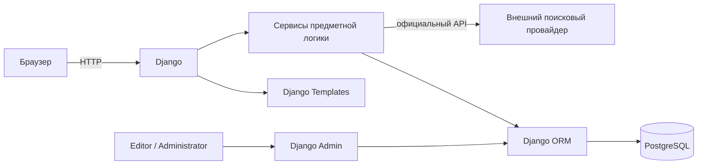
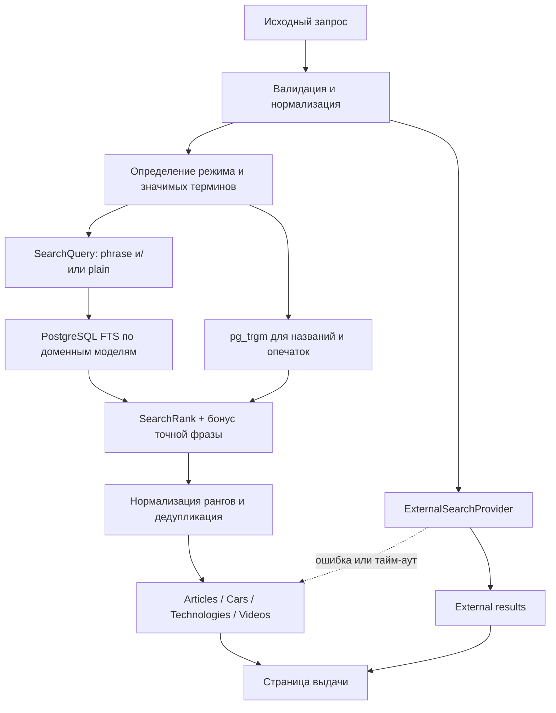
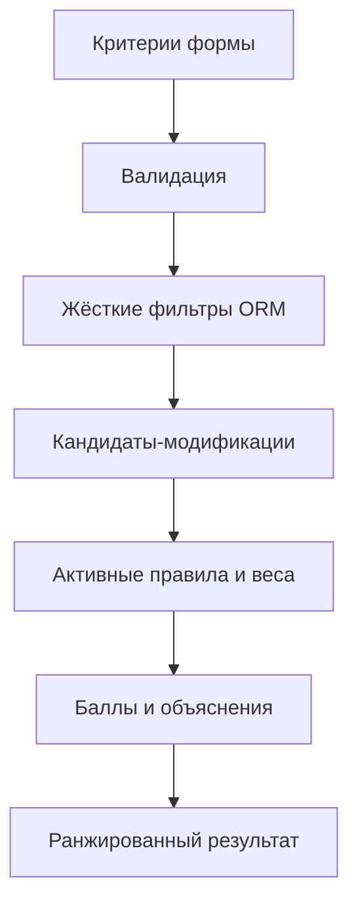

# Архитектура приложения

## 1. Архитектурные цели

Архитектура должна поддерживать связанную базу знаний, оставаться понятной для курсового проекта и не создавать инфраструктуру раньше реальной потребности. Предлагается модульный монолит на Django с серверным HTML-интерфейсом.

На текущем этапе этот документ является проектным решением: Django-проект, зависимости и приложения ещё не создаются.

## 2. Технологическая схема



- **Django Templates** формируют HTML на сервере.
- **JavaScript** используется точечно для сравнения, динамических фильтров и улучшения форм, но базовые сценарии не должны полностью зависеть от него.
- **Bootstrap или Tailwind** выбирается до начала frontend-работ; одновременно использовать оба не следует.
- **PostgreSQL** хранит предметные данные, контент и правила; Full Text Search и `pg_trgm` обеспечивают внутренний поиск.
- **Внешний поисковый API** является необязательным источником. Он вызывается через адаптер и не влияет на доступность внутренней выдачи.
- **Docker Compose** после начала реализации поднимает веб-приложение и PostgreSQL.
- **pytest** проверяет модели, сервисы и представления; **Playwright** — критические пользовательские сценарии.

## 3. Предлагаемая структура Django

```text
config/              # настройки проекта, URL, ASGI/WSGI
apps/
  core/              # общие страницы и небольшие общие средства
  cars/              # автомобильная предметная модель и каталог
  knowledge/         # статьи, видео, категории, теги и связи материалов
  search/            # разбор запросов, внутренний/внешний поиск, ранжирование
  recommendations/   # критерии, правила, оценка и объяснения
  users/             # пользовательская модель и профиль, если нужен
templates/
static/
tests/                # общие интеграционные и e2e-тесты
```

Это предварительная структура, а не требование создать все приложения сразу.

### `core`

Отвечает за главную страницу, общие контекстные данные и инфраструктурные утилиты. В нём нельзя накапливать предметные модели только потому, что им не нашли место.

### `cars`

Содержит основную автомобильную иерархию, справочники компонентов, рынки, комплектации, технологии и ADAS. Здесь же находятся запросы каталога и сервис сравнения, поскольку сравнение непосредственно зависит от модели автомобиля.

### `knowledge`

Содержит статьи, `VideoResource`, категории, теги, источники и явные связи материалов с предметными сущностями. Отвечает за публикацию и получение связанных материалов. Видео размещается здесь, а не в `search`, потому что это управляемый контент базы знаний, существующий независимо от поискового запроса.

### `search`

Обязательное отдельное приложение информационно-поисковой подсистемы. Оно отвечает за:

- валидацию и нормализацию запроса;
- определение режима «слово / словосочетание / предложение»;
- построение `SearchVector` и `SearchQuery`;
- получение `SearchRank` и триграммного сходства;
- поиск по селекторам `knowledge` и `cars`;
- приведение результатов к единому DTO и группировку;
- вызов настроенного `ExternalSearchProvider`;
- обработку тайм-аутов и частичных отказов.

Приложение `search` не владеет копиями статей, автомобилей или внешних результатов. Предметные модели остаются в своих приложениях, а поисковые сервисы выполняют чтение.

### `recommendations`

Содержит конфигурацию допустимых правил и сервис подбора. Принимает типизированные критерии, получает кандидатов из `cars`, применяет фильтры и веса и возвращает объекты результата с объяснениями. Представления не должны содержать алгоритм оценки.

### `users`

Содержит минимальную пользовательскую модель `User(AbstractUser)`. Она подключается через `AUTH_USER_MODEL = "users.User"` до первой миграции, чтобы дальнейшее расширение профиля не требовало замены базовой таблицы. Роли Editor и Administrator реализуются группами и разрешениями Django.

## 4. Слои внутри приложения

```text
URL → View/Form → Service/Selector → Model/ORM → PostgreSQL
                    ↓
                 Template
```

- **Models** обеспечивают структуру и локальные инварианты данных.
- **Forms** валидируют пользовательский ввод.
- **Selectors/QuerySets** инкапсулируют сложное чтение, `select_related` и `prefetch_related`.
- **Services** выполняют сценарии, которые затрагивают несколько моделей, особенно сравнение и подбор.
- **Views** координируют запрос и ответ, но не содержат тяжёлую предметную логику.
- **Templates** отвечают за представление и не выполняют сложных запросов.

Отдельные слои вводятся по мере появления сложности. Для простого CRUD допустимы стандартные Django-представления без формального сервисного класса.

## 5. Потоки ключевых сценариев

### Просмотр страницы автомобиля

1. Представление получает активную модель по slug.
2. Оптимизированный запрос загружает поколения, модификации и основные связи.
3. `knowledge` возвращает связанные опубликованные статьи и активные видеоресурсы.
4. Шаблон выводит обзор и позволяет выбрать поколение/модификацию.

### Информационно-поисковая подсистема



#### Разбор запроса

`QueryParser` сохраняет исходную строку, выполняет Unicode-нормализацию, приводит повторные пробелы к одному, ограничивает длину и формирует нормализованный вариант. Тип запроса определяется прозрачно: один значимый токен — слово; несколько токенов без признака предложения — словосочетание; более длинная конструкция или завершающий знак — предложение. Эта классификация влияет на стратегию ранжирования, но не блокирует резервные стратегии.

Для русского текста используется конфигурируемая PostgreSQL FTS-конфигурация (предварительно `russian`). Марки, коды моделей и латинские технические обозначения дополнительно сопоставляются по исходным нормализованным полям и триграммному сходству, чтобы морфология русского языка не ухудшала поиск `BYD`, `Zeekr 001` или `PHEV`.

#### Внутренний поиск и ранжирование

Каждая группа имеет собственный `SearchVector` с весами: название — `A`, краткое описание — `B`, основной текст — `C`, второстепенные данные — `D`. `SearchQuery(..., search_type="phrase")` вычисляет фразовый ранг, а обычный `SearchQuery` — совпадение значимых терминов. Итоговая оценка формируется из `SearchRank`, бонуса фразы и, при необходимости, `TrigramSimilarity`.

Формула централизована в `apps/search/services/ranking.py` и покрыта тестами. Внутри каждой группы используется:

```text
score = full_text_rank
      + 0.70 × phrase_rank
      + 0.25 × trigram_similarity
      + 1.00 × exact_title
      + 0.40 × literal_phrase
```

`full_text_rank` объединяет ранг отдельных значимых терминов и дополнительный коэффициент `0.35` за покрытие полного `plain`-запроса. `exact_title` и `literal_phrase` — булевы бонусы. Триграммная часть применяется к заголовкам и названиям, а не ко всему длинному тексту; отбор использует оператор `pg_trgm`, а similarity участвует в сортировке. Ранги используются для порядка внутри группы; сравнивать абсолютные ранги статьи и автомобиля необязательно, потому что группы выводятся раздельно.

Алгоритмы по типам запроса:

- **слово:** plain `SearchQuery`; при недостаточном числе/качестве результатов — триграммный fallback;
- **словосочетание:** параллельно phrase и plain query, затем дополнительный вес фразового совпадения;
- **предложение:** PostgreSQL выделяет лексемы и стоп-слова, прикладной слой сохраняет значимые автомобильные обозначения; plain query ищет по терминам, phrase query даёт бонус сохранившим порядок фрагментам.

`SearchCoordinator` получает ограниченный набор результатов от `ArticleSearch`, `CarSearch`, `TechnologySearch` и `VideoSearch`, приводит их к DTO `{group, title, snippet, url, score, source}` и удаляет дубликаты внутри группы.

В реализации этапа 2 роль координатора выполняет компактный `InternalSearchService`. Разбор находится в `query_parser.py`, общие коэффициенты и ORM-аннотации — в `ranking.py`. Такой вариант сохраняет разделение ответственности без избыточной иерархии классов. Страница `/search/` вызывает только этот сервис и не содержит поисковой логики.

Начиная с этапа 3, координатор после успешной валидации запускает настроенный `ExternalSearchProvider`. Внутренний и внешний результаты остаются раздельными: четыре внутренних группы формируются PostgreSQL-сервисом, а `External results` содержит только временные DTO интернет-выдачи.

#### Внешний поиск

`ExternalSearchProvider` — интерфейс прикладного слоя, а не Django-модель:

```text
search(query, *, limit, language) -> list[ExternalSearchResult]
```

`ExternalSearchResult` содержит `title`, `url`, `description`, `source` и необязательную дату. Конкретный адаптер выбирается настройкой `EXTERNAL_SEARCH_PROVIDER`; ключ, endpoint, тайм-аут, лимит и язык поступают из окружения. Пустая реализация (`NullExternalSearchProvider`) возвращает пустой список без сетевого вызова, когда провайдер или ключ не настроен.

Текущий адаптер — `TavilyExternalSearchProvider` для официального Tavily Search API. Он выполняет `POST https://api.tavily.com/search` с исходным запросом, режимом `basic`, ограниченным числом результатов и без генерации ответа (`include_answer=false`). Поля `title`, `url` и `content` преобразуются в общий DTO, а `source` извлекается из домена безопасного URL. `BraveSearchProvider` сохранён как дополнительный адаптер, но не активируется при `EXTERNAL_SEARCH_PROVIDER=tavily`. Оба HTTP-вызова реализованы стандартной библиотекой Python, поэтому новая зависимость не добавлена.

`SearchCoordinator` сначала завершает `InternalSearchService`, затем передаёт внешнему провайдеру исходную пользовательскую строку. Ответ адаптера ограничивается по размеру; принимаются только `http`/`https` URL без встроенных credentials. Шаблон использует стандартное экранирование Django и не выводит HTML провайдера как безопасный.

HTML поисковых систем не извлекается. Вызов имеет короткий настраиваемый тайм-аут и перехватывает connection error, timeout, HTTP error, `429`, превышение размера и неверный JSON/контракт. Такие ошибки преобразуются в безопасный статус и не отменяют внутреннюю выдачу. Внешние результаты не сохраняются в основной БД; кэш в текущей реализации отсутствует.

#### Пример прохождения запроса

Для запроса «Какие электромобили BYD используют Blade Battery?»:

1. нормализатор сохраняет исходный текст и получает строку `какие электромобили byd используют blade battery`;
2. парсер классифицирует запрос как предложение и выделяет значимые термины `электромобиль`, `BYD`, `Blade Battery`;
3. строятся обычный и фразовый `SearchQuery`; `SearchVector` ищет совпадения в статьях, моделях, технологиях и видео;
4. `SearchRank` поднимает документы с несколькими терминами, а точное `Blade Battery` получает фразовый бонус;
5. результаты распределяются: статья о Blade Battery — в `Articles`, модели BYD — в `Cars`, технология — в `Technologies`, обзор — в `Videos`;
6. тот же исходный запрос передаётся настроенному `ExternalSearchProvider`; его ссылки попадают только в `External results`;
7. если API отвечает ошибкой, первые четыре внутренние группы всё равно отображаются.

#### Помощь пользователю при формировании поискового запроса

`SearchAssistanceService` дополняет основной поиск, не изменяя `InternalSearchService` и `ExternalSearchProvider`. Лёгкий JSON endpoint `/search/suggest/?q=...` при длине от двух символов ищет только по локальным названиям `Brand`, объединённому названию `Model`, `Technology` и заголовку опубликованной `Article`. Ответ ограничен семью DTO `{label, type, value}`; Tavily и полнотекстовый поиск при вводе не запускаются.

Для пустой или слабой выдачи сервис сравнивает максимальный внутренний score с централизованным порогом. Похожие названия выбираются `TrigramSimilarity` с ограниченным числом кандидатов. Исходный запрос не переписывается: пользователь видит «Возможно, вы имели в виду» и сам запускает предложенный вариант. Пустая страница и отсутствие результатов также показывают фиксированные учебные примеры запросов.

Обычный JavaScript-клиент выполняет запрос после debounce 250 мс, отменяет устаревший fetch и поддерживает мышь, ArrowUp/ArrowDown, Enter и Escape. Dropdown имеет роли listbox/option и ARIA-связь с полем.

### Сравнение

Сервис `cars` принимает от двух до четырёх идентификаторов модификаций, загружает единый набор параметров и возвращает строки сравнения. Он различает `NULL`, ноль и неприменимое поле.

На этапе 5 реализован первый пользовательский сценарий для двух модификаций. Маршрут `/compare/` принимает GET-параметры `left` и `right`; `ComparisonForm` проверяет существование и различие выбранных активных модификаций. Сервис `cars.services.comparison` одним согласованным queryset загружает иерархию, силовую установку, рынки, комплектации, ADAS и технологии, после чего формирует секции одинаковых параметров. Состояние не сохраняется в сессии или БД. `Нет данных` обозначает отсутствующий факт, а `Не применяется` — поле, неприменимое к типу силовой установки.

### Подбор



Правило использует только разрешённые поля и операторы. Значения правил не преобразуются в произвольный Python-код или SQL. Жёсткие фильтры применяются в БД, мягкие правила — в небольшом чистом Python-сервисе, который удобно тестировать.

## 6. Авторизация и публикация

- Guest и User читают только активные предметные сущности, опубликованные статьи и активные видеоресурсы.
- Editor получает модельные разрешения на изменение контента и предметных данных.
- Administrator управляет пользователями, группами, разрешениями и справочниками.
- Статусы публикации используются для статей. Для основных сущностей предпочтительны `is_active`/архивирование там, где данные нельзя безопасно удалить.
- Django Admin является редакторским интерфейсом первой версии; отдельная редакторская панель не планируется.

### Пользовательский интерфейс этапа 4

Серверный интерфейс построен на Django Templates и Bootstrap 5 без отдельной frontend-сборки. Общий `base.html` содержит навигацию, компактный поиск, сообщения, состояния авторизации и footer. Представления остаются в предметных приложениях: главная — в `core`, каталог и страницы автомобильных сущностей — в `cars`, публикации — в `knowledge`, а регистрация и стандартные auth-представления — в `users`.

Публичные маршруты образуют понятный путь по предметной модели: `/brands/` → `/brands/<slug>/` → `/cars/<slug>/` → `/cars/modifications/<slug>/`. Сравнение доступно по `/compare/?left=<id>&right=<id>`, статьи — по `/articles/` и `/articles/<slug>/`, технологии — по `/technologies/` и `/technologies/<slug>/`. Поиск не дублирует логику этих представлений: DTO внутренней выдачи получают URL соответствующих detail pages.

Фильтрация `/cars/` выполняется ORM по существующим связям поколений и модификаций: марка, кузов, тип силовой установки и привод. Параметры находятся в query string; новые таблицы или денормализованные поля для интерфейса не создаются.

## 7. Тестовая архитектура

- **Модульные тесты:** ограничения моделей, нормализация/классификация запроса, расчёт ранга, DTO провайдера и каждый тип правила.
- **Интеграционные тесты:** FTS по слову, фразе и предложению; приоритет точной фразы; `pg_trgm`-опечатка; группировка и фильтрация неактивного контента; каталог, сравнение и подбор.
- **Контрактные тесты:** адаптер внешнего провайдера с подменённым HTTP-клиентом, пустая конфигурация, ошибка и тайм-аут без реального сетевого вызова.
- **Тесты представлений:** статусы, шаблоны, пагинация, недоступность черновиков и сохранение внутренней выдачи при сбое внешнего API.
- **Playwright:** слово/фраза/предложение, отображение пяти групп, просмотр каталога, сравнение, подбор, вход редактора и базовая проверка адаптивности.

Тесты должны использовать небольшие фабрики или фикстуры; выбор дополнительной библиотеки фабрик требует отдельного обоснования.

## 8. Зависимости и внешние интеграции

Минимальный предварительный набор: Django, драйвер PostgreSQL, pytest-интеграция с Django и Playwright. `django.contrib.postgres` предоставляет ORM-инструменты поиска, а расширение PostgreSQL `pg_trgm` включается миграцией и не является Python-зависимостью. HTTP-клиент или SDK конкретного внешнего провайдера выбирается только после утверждения API и добавляется лишь при необходимости. Конкретные пакеты и версии фиксируются на этапе настройки проекта. REST-фреймворк, Celery, Redis, Elasticsearch и внешний AI API в первой версии не требуются.

## 9. Эволюция архитектуры

Новые приложения, фоновые задачи, кэш или отдельный API добавляются только по подтверждённому сценарию. Изменение границ приложений должно одновременно отражаться в `domain-model.md`, `database-schema.md` и этом документе.
