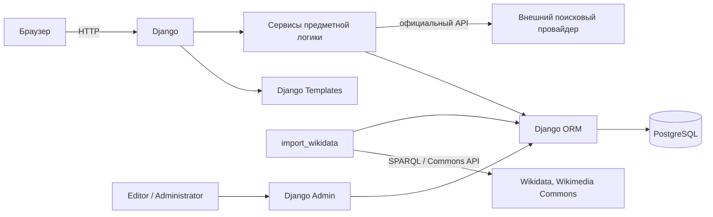
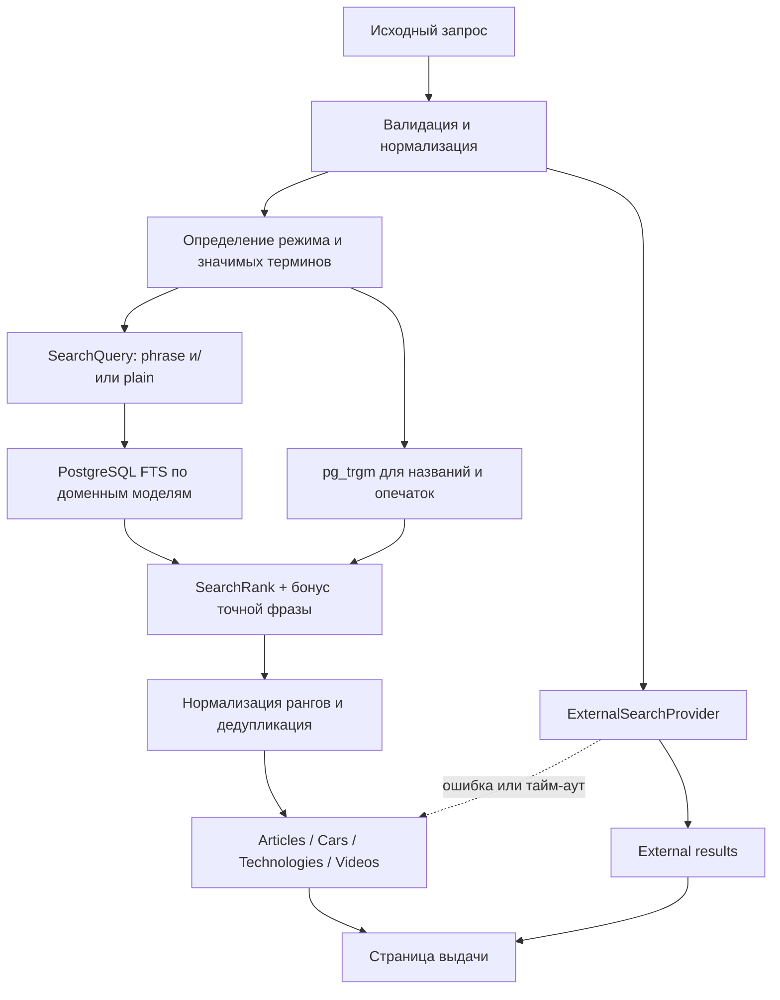
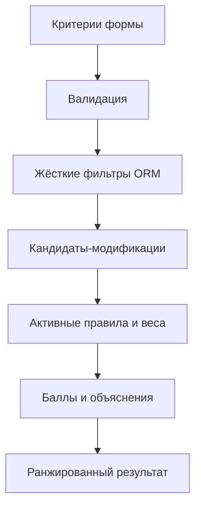

# Архитектура приложения

## 1. Архитектурные цели

Архитектура должна поддерживать связанную базу знаний, оставаться понятной для курсового проекта и не создавать инфраструктуру раньше реальной потребности. Предлагается модульный монолит на Django с серверным HTML-интерфейсом.

Документ начинался как проектное решение; сейчас он описывает реализованную структуру и отмечает оставшиеся ограничения.

## 2. Технологическая схема



- **Django Templates** формируют HTML на сервере.
- **JavaScript** используется точечно для сравнения, динамических фильтров и улучшения форм, но базовые сценарии не должны полностью зависеть от него.
- **Bootstrap 5** выбран CSS-фреймворком интерфейса; Tailwind не используется.
- **PostgreSQL** хранит предметные данные, контент и правила; Full Text Search и `pg_trgm` обеспечивают внутренний поиск.
- **Внешний поисковый API** является необязательным источником. Он вызывается через адаптер и не влияет на доступность внутренней выдачи.
- **Docker Compose** после начала реализации поднимает веб-приложение и PostgreSQL.
- **pytest** проверяет модели, сервисы и представления; **Playwright** — критические пользовательские сценарии.

## 3. Предлагаемая структура Django

```text
config/              # настройки проекта, URL, ASGI/WSGI
apps/
  core/              # общие страницы и небольшие общие средства
  cars/              # автомобильная предметная модель и каталог
  knowledge/         # статьи, видео, категории, теги и связи материалов
  search/            # разбор запросов, внутренний/внешний поиск, ранжирование
  recommendations/   # критерии, правила, оценка и объяснения
  users/             # пользовательская модель и профиль, если нужен
templates/
static/
tests/                # общие интеграционные и e2e-тесты
```

Это предварительная структура, а не требование создать все приложения сразу.

### `core`

Отвечает за главную страницу, общие контекстные данные и инфраструктурные утилиты. В нём нельзя накапливать предметные модели только потому, что им не нашли место.

### `cars`

Содержит основную автомобильную иерархию, справочники компонентов, рынки, комплектации, технологии и ADAS. Здесь же находятся запросы каталога и сервис сравнения, поскольку сравнение непосредственно зависит от модели автомобиля.

### `knowledge`

Содержит статьи, `VideoResource`, категории, теги, источники, комментарии `ArticleComment` и явные связи материалов с предметными сущностями. Отвечает за публикацию и получение связанных материалов. Видео размещается здесь, а не в `search`, потому что это управляемый контент базы знаний, существующий независимо от поискового запроса.

### `search`

Обязательное отдельное приложение информационно-поисковой подсистемы. Оно отвечает за:

- валидацию и нормализацию запроса;
- определение режима «слово / словосочетание / предложение»;
- построение `SearchVector` и `SearchQuery`;
- получение `SearchRank` и триграммного сходства;
- поиск по селекторам `knowledge` и `cars`;
- приведение результатов к единому DTO и группировку;
- вызов настроенного `ExternalSearchProvider`;
- обработку тайм-аутов и частичных отказов.

Приложение `search` не владеет копиями статей, автомобилей или внешних результатов. Предметные модели остаются в своих приложениях, а поисковые сервисы выполняют чтение.

### `recommendations`

Содержит конфигурацию допустимых правил и сервис подбора. Принимает типизированные критерии, получает кандидатов из `cars`, применяет фильтры и веса и возвращает объекты результата с объяснениями. Представления не должны содержать алгоритм оценки.

### `users`

Содержит минимальную пользовательскую модель `User(AbstractUser)`. Она подключается через `AUTH_USER_MODEL = "users.User"` до первой миграции, чтобы дальнейшее расширение профиля не требовало замены базовой таблицы. Роли Editor и Administrator реализуются группами и разрешениями Django.

Здесь же находятся личные функции пользователя: `FavoriteArticle` и `FavoriteModel` — две явные таблицы «пользователь — объект» с уникальной парой вместо универсальной полиморфной связи. Переключение выполняется POST-запросом с CSRF-защитой, возврат по параметру `next` разрешён только на этот же сайт (`url_has_allowed_host_and_scheme`).

## 4. Слои внутри приложения

```text
URL → View/Form → Service/Selector → Model/ORM → PostgreSQL
                    ↓
                 Template
```

- **Models** обеспечивают структуру и локальные инварианты данных.
- **Forms** валидируют пользовательский ввод.
- **Selectors/QuerySets** инкапсулируют сложное чтение, `select_related` и `prefetch_related`.
- **Services** выполняют сценарии, которые затрагивают несколько моделей, особенно сравнение и подбор.
- **Views** координируют запрос и ответ, но не содержат тяжёлую предметную логику.
- **Templates** отвечают за представление и не выполняют сложных запросов.

Отдельные слои вводятся по мере появления сложности. Для простого CRUD допустимы стандартные Django-представления без формального сервисного класса.

## 5. Потоки ключевых сценариев

### Просмотр страницы автомобиля

1. Представление получает активную модель по slug.
2. Оптимизированный запрос загружает поколения, модификации и основные связи.
3. `knowledge` возвращает связанные опубликованные статьи и активные видеоресурсы.
4. Шаблон выводит обзор и позволяет выбрать поколение/модификацию.

### Информационно-поисковая подсистема



#### Разбор запроса

`QueryParser` сохраняет исходную строку, выполняет Unicode-нормализацию, приводит повторные пробелы к одному, ограничивает длину и формирует нормализованный вариант. Тип запроса определяется прозрачно: один значимый токен — слово; несколько токенов без признака предложения — словосочетание; более длинная конструкция или завершающий знак — предложение. Эта классификация влияет на стратегию ранжирования, но не блокирует резервные стратегии.

Для русского текста используется конфигурируемая PostgreSQL FTS-конфигурация (предварительно `russian`). Марки, коды моделей и латинские технические обозначения дополнительно сопоставляются по исходным нормализованным полям и триграммному сходству, чтобы морфология русского языка не ухудшала поиск `BYD`, `Zeekr 001` или `PHEV`.

#### Внутренний поиск и ранжирование

Каждая группа имеет собственный `SearchVector` с весами: название — `A`, краткое описание — `B`, основной текст — `C`, второстепенные данные — `D`. `SearchQuery(..., search_type="phrase")` вычисляет фразовый ранг, а обычный `SearchQuery` — совпадение значимых терминов. Итоговая оценка формируется из `SearchRank`, бонуса фразы и, при необходимости, `TrigramSimilarity`.

Формула централизована в `apps/search/services/ranking.py` и покрыта тестами. Внутри каждой группы используется:

```text
score = full_text_rank
      + 0.70 × phrase_rank
      + 0.25 × trigram_similarity
      + 1.00 × exact_title
      + 0.40 × literal_phrase
```

`full_text_rank` объединяет ранг отдельных значимых терминов и дополнительный коэффициент `0.35` за покрытие полного `plain`-запроса. `exact_title` и `literal_phrase` — булевы бонусы. Триграммная часть применяется к заголовкам и названиям, а не ко всему длинному тексту; отбор использует оператор `pg_trgm`, а similarity участвует в сортировке. Ранги используются для порядка внутри группы; сравнивать абсолютные ранги статьи и автомобиля необязательно, потому что группы выводятся раздельно.

Алгоритмы по типам запроса:

- **слово:** plain `SearchQuery`; триграммное условие по коротким названиям всегда добавляется через `OR`, поэтому опечатка находится даже при пустой FTS-выдаче, а `TrigramSimilarity` влияет на порядок только с весом 0.25;
- **словосочетание:** параллельно phrase и plain query, затем дополнительный вес фразового совпадения;
- **предложение:** PostgreSQL выделяет лексемы и стоп-слова, прикладной слой сохраняет значимые автомобильные обозначения; plain query ищет по терминам, phrase query даёт бонус сохранившим порядок фрагментам.

Логически поиск разделяется на поиск статей, автомобилей, технологий и видео; результаты приводятся к DTO `SearchResult` (`result_type`, `title`, `description`, `url`, `score`, `source` и поля видео) и дедуплицируются внутри группы. В каждой группе выводится не больше 12 результатов; раздельная пагинация групп пока не реализована.

В реализации этапа 2 роль координатора выполняет компактный `InternalSearchService`. Разбор находится в `query_parser.py`, общие коэффициенты и ORM-аннотации — в `ranking.py`. Такой вариант сохраняет разделение ответственности без избыточной иерархии классов. Страница `/search/` вызывает только этот сервис и не содержит поисковой логики.

Начиная с этапа 3, координатор после успешной валидации запускает настроенный `ExternalSearchProvider`. Внутренний и внешний результаты остаются раздельными: четыре внутренних группы формируются PostgreSQL-сервисом, а `External results` содержит только временные DTO интернет-выдачи.

#### Внешний поиск

`ExternalSearchProvider` — интерфейс прикладного слоя, а не Django-модель:

```text
search(query, *, limit, language) -> list[ExternalSearchResult]
```

`ExternalSearchResult` содержит `title`, `url`, `description`, `source` и необязательную дату. Конкретный адаптер выбирается настройкой `EXTERNAL_SEARCH_PROVIDER`; ключ, endpoint, тайм-аут, лимит и язык поступают из окружения. Пустая реализация (`NullExternalSearchProvider`) возвращает пустой список без сетевого вызова, когда провайдер или ключ не настроен.

Текущий адаптер — `TavilyExternalSearchProvider` для официального Tavily Search API. Он выполняет `POST https://api.tavily.com/search` с исходным запросом, режимом `basic`, ограниченным числом результатов и без генерации ответа (`include_answer=false`). Поля `title`, `url` и `content` преобразуются в общий DTO, а `source` извлекается из домена безопасного URL. `BraveSearchProvider` сохранён как дополнительный адаптер, но не активируется при `EXTERNAL_SEARCH_PROVIDER=tavily`. Оба HTTP-вызова реализованы стандартной библиотекой Python, поэтому новая зависимость не добавлена.

`SearchCoordinator` сначала завершает `InternalSearchService`, затем передаёт внешнему провайдеру исходную пользовательскую строку. Ответ адаптера ограничивается по размеру; принимаются только `http`/`https` URL без встроенных credentials. Шаблон использует стандартное экранирование Django и не выводит HTML провайдера как безопасный.

HTML поисковых систем не извлекается. Вызов имеет короткий настраиваемый тайм-аут и перехватывает connection error, timeout, HTTP error, `429`, превышение размера и неверный JSON/контракт. Такие ошибки преобразуются в безопасный статус и не отменяют внутреннюю выдачу. Внешние результаты не сохраняются в основной БД; кэш в текущей реализации отсутствует.

#### Пример прохождения запроса

Для запроса «Какие электромобили BYD используют Blade Battery?»:

1. нормализатор сохраняет исходный текст, выполняет Unicode-нормализацию и сжимает пробелы (регистр приводит PostgreSQL при построении `tsquery`);
2. парсер классифицирует запрос как предложение, убирает служебные слова из короткого прикладного списка и получает термины `электромобили`, `BYD`, `Blade`, `Battery`, а последовательность латинских слов `Blade Battery` — как кандидат фразы; морфологию (`электромобили` → `электромобиль`) выполняет конфигурация `russian`;
3. строятся обычный и фразовый `SearchQuery`; `SearchVector` ищет совпадения в статьях, моделях, технологиях и видео;
4. `SearchRank` поднимает документы с несколькими терминами, а точное `Blade Battery` получает фразовый бонус;
5. результаты распределяются: статья о Blade Battery — в `Articles`, модели BYD — в `Cars`, технология — в `Technologies`, обзор — в `Videos`;
6. тот же исходный запрос передаётся настроенному `ExternalSearchProvider`; его ссылки попадают только в `External results`;
7. если API отвечает ошибкой, первые четыре внутренние группы всё равно отображаются.

#### Помощь пользователю при формировании поискового запроса

`SearchAssistanceService` дополняет основной поиск, не изменяя `InternalSearchService` и `ExternalSearchProvider`. Лёгкий JSON endpoint `/search/suggest/?q=...` при длине от двух символов ищет только по локальным названиям `Brand`, объединённому названию `Model`, `Technology` и заголовку опубликованной `Article`. Ответ ограничен семью DTO `{label, type, value}`; Tavily и полнотекстовый поиск при вводе не запускаются.

Для пустой или слабой выдачи сервис сравнивает максимальный внутренний score с централизованным порогом. Похожие названия выбираются `TrigramSimilarity` с ограниченным числом кандидатов. Исходный запрос не переписывается: пользователь видит «Возможно, вы имели в виду» и сам запускает предложенный вариант. Пустая страница и отсутствие результатов также показывают фиксированные учебные примеры запросов.

Обычный JavaScript-клиент выполняет запрос после debounce 250 мс, отменяет устаревший fetch и поддерживает мышь, ArrowUp/ArrowDown, Enter и Escape. Dropdown имеет роли listbox/option и ARIA-связь с полем.

#### Исправление запроса («Возможно, вы имели в виду» и «Показаны результаты по запросу»)

`QueryCorrector` (`apps/search/services/correction.py`) исправляет запрос по словам, поэтому в предложении меняются только ошибочные слова. Словарь строится из БД (названия активных марок, моделей и технологий, заголовки опубликованных статей) и дополняется коротким глоссарием предметных слов и стоп-словами парсера. Слово из словаря, число или слово короче двух букв не меняются. Для остальных слов правила применяются по порядку, первое сработавшее побеждает:

1. русское написание марки из таблицы `RUSSIAN_SPELLINGS` («зикр» → Zeekr, «джили» → Geely);
2. неверная раскладка: слово, переведённое по таблице клавиш ЙЦУКЕН ↔ QWERTY, есть в словаре («инв» → BYD, «Яуулк» → Zeekr);
3. опечатка: ближайшее слово словаря того же алфавита по `difflib.SequenceMatcher.ratio()` (стандартная библиотека). Порог 0,75 для латиницы (от 3 букв) и 0,82 для кириллицы (от 5 букв); при равенстве побеждает слово, первое по алфавиту. Кириллическое слово с известной основой (другое окончание: «электромобилями») не исправляется, морфологию выполняет FTS;
4. латинское название, набранное русскими буквами: транслитерация («дж» → j) и сравнение с латинскими словами («тигго» → Tiggo, «монжаро» → Monjaro);
5. неверная раскладка вместе с опечаткой («ktrnhjvj,bkm» → «электромобиль»).

`SearchCoordinator` сначала выполняет внутренний поиск по введённому запросу. Если найдено исправление из правил 1–2 (таблица или раскладка), оно считается уверенным и применяется сразу. Исправление опечатки применяется, только если исходная выдача слабая (порог `WEAK_RESULT_SCORE`), а исправленный запрос даёт больший лучший score. Тогда исправленный текст используют внутренний поиск, прямой ответ и внешний провайдер. Иначе исправление только предлагается. Параметр `exact=1` (ссылка «Искать вместо этого») отключает автоматическую замену. Autocomplete использует тот же сервис: исправленный запрос идёт первой подсказкой, названия ищутся по префиксу в другой раскладке и по исправленному тексту, а при пустом результате используется триграммный `fuzzy`. Сервис детерминирован, не использует внешний AI API и не хранит историю запросов. `pg_trgm` по-прежнему дополняет FTS в самом поиске и в блоке похожих названий.

#### Прямой ответ на вопрос о факте

Полнотекстовый поиск находит документы, в которых *упоминаются* слова запроса, но не умеет интерпретировать «самый большой». Поэтому `SearchCoordinator` дополнительно вызывает `FactQuestionService` (`apps/search/services/fact_questions.py`). Сервис срабатывает, только если в запросе есть слово-ранжирование («самый», «наибольший», «максимальный», «минимальный»…) и основа слова, называющая параметр (`запас` → `Modification.range_km`, `разгон`/`быстр` → `acceleration_0_100_s`, `мощн` → `Powertrain.system_power_kw` и т. д.). Сравнение по основам слов (`запасам` начинается с `запас`) заодно переносит ошибки в окончаниях.

Направление сортировки берётся из «лучшего» порядка параметра (запас хода — по убыванию, разгон — по возрастанию), а явные «наибольший/наименьший» его переопределяют. Марка распознаётся по названию из таблицы `Brand`, тип силовой установки — по кодам BEV/PHEV/ICE и словам «электромобиль», «гибрид», «бензин». Итог — один ORM-запрос `ORDER BY <параметр>` с `LIMIT 3` по активным модификациям и исключением `NULL`. Ответ (`FactAnswer`) содержит текстовое объяснение распознанного и показывается над группами выдачи как «Ответ из базы знаний» со ссылкой на сравнение двух первых модификаций. Новых таблиц и миграций нет.

### Сравнение

Сервис `cars` принимает от двух до четырёх идентификаторов модификаций, загружает единый набор параметров и возвращает строки сравнения. Он различает `NULL`, ноль и неприменимое поле.

На этапе 5 реализован первый пользовательский сценарий для двух модификаций. Маршрут `/compare/` принимает GET-параметры `left` и `right`; `ComparisonForm` проверяет существование и различие выбранных активных модификаций. Сервис `cars.services.comparison` одним согласованным queryset загружает иерархию, силовую установку, рынки, комплектации, ADAS и технологии, после чего формирует секции одинаковых параметров. Состояние не сохраняется в сессии или БД. `Нет данных` обозначает отсутствующий факт, а `Не применяется` — поле, неприменимое к типу силовой установки.

### Подбор



Правило использует только разрешённые поля и операторы. Значения правил не преобразуются в произвольный Python-код или SQL. Жёсткие фильтры применяются в БД, мягкие правила — в небольшом чистом Python-сервисе, который удобно тестировать.

Этап 6 реализован маршрутом `/recommendations/`. `RecommendationForm` типизирует GET-параметры, а `RecommendationEngine` загружает активные `Modification` с нужными связями, проверяет пользовательские обязательные условия и пожелания, затем применяет активные `RecommendationRule`/`RecommendationCondition`. Модели правил реально используют поля `body_type`, `powertrain_type`, `drive_type`, `market`, `price`, `range_km`, `power_kw`, `seats` и операторы `eq`, `in`, `gte`, `lte`; дополнительные пользовательские пожелания `battery_capacity`, `technology`, `adas` вычисляются сервисом только по нормализованным связям автомобилей.

Score равен округлённой доле выполненного веса от суммарного веса пользовательских критериев и активных правил. Жёсткое невыполненное условие исключает точное совпадение, мягкое только уменьшает score. При отсутствии точных результатов тот же детерминированный расчёт сортирует ближайшие варианты сначала по числу выполненных обязательных условий, затем по score; интерфейс явно помечает их как частичные. Бюджет проверяется по минимальной активной цене `TrimLevel` выбранного рынка и валюты. Без выбранного рынка и валюты бюджет не принимается, а конвертация валют не выполняется.

## 6. Авторизация и публикация

- Guest и User читают только активные предметные сущности, опубликованные статьи и активные видеоресурсы.
- Editor получает модельные разрешения на изменение контента и предметных данных.
- Administrator управляет пользователями, группами, разрешениями и справочниками.
- Статусы публикации используются для статей. Для основных сущностей предпочтительны `is_active`/архивирование там, где данные нельзя безопасно удалить.
- Django Admin является редакторским интерфейсом первой версии; отдельная редакторская панель не планируется.
- Группы создаёт идемпотентная команда `python manage.py setup_roles` (`apps/users/roles.py`). `Editor` получает права `view`/`add`/`change` на модели `cars`, `knowledge` и `recommendations`, а удалять может только строки связей `RelatedArticle` и `RecommendationCondition`. `Administrator` получает все права этих приложений, а также управление пользователями и группами. Для входа в админку пользователю дополнительно нужен статус персонала.

### Пользовательский интерфейс этапа 4

Серверный интерфейс построен на Django Templates и Bootstrap 5 без отдельной frontend-сборки. Собственные CSS и JS подключаются тегом `` (`apps/core/templatetags/assets.py`): он работает как ``, но добавляет к адресу время изменения файла (`?v=…`). Без сборки имена файлов не содержат хеша, и браузер мог показывать устаревшие стили после правок; с версией в адресе изменённый файл загружается заново. Общий `base.html` содержит навигацию, компактный поиск, сообщения, состояния авторизации и footer. Представления остаются в предметных приложениях: главная — в `core`, каталог и страницы автомобильных сущностей — в `cars`, публикации — в `knowledge`, а регистрация и стандартные auth-представления — в `users`.

Публичные маршруты образуют понятный путь по предметной модели: `/brands/` → `/brands/<slug>/` → `/cars/<slug>/` → `/cars/modifications/<slug>/`. Сравнение доступно по `/compare/?left=<id>&right=<id>`, статьи — по `/articles/` и `/articles/<slug>/`, технологии — по `/technologies/` и `/technologies/<slug>/`. Поиск не дублирует логику этих представлений: DTO внутренней выдачи получают URL соответствующих detail pages.

Фильтрация `/cars/` вынесена в `cars.services.catalog.filter_vehicle_models` и валидируется `CarFilterForm`. Марка проверяется на модели, а кузов, тип силовой установки, привод, рынок и цена — одним подзапросом `EXISTS` по модификации, поэтому все условия должны выполняться на одной и той же модификации. Рынок и цена проверяются внутри одного предложения рынка: активная комплектация с ценой в выбранной валюте и в заданном диапазоне. Цена без валюты не применяется, а `NULL` не удовлетворяет ценовому фильтру. Параметры находятся в query string; новые таблицы или денормализованные поля для интерфейса не создаются.

Списки моделей (12 на странице), марок (24), статей (10) и источников (20) используют `Paginator` и общий шаблон `includes/pagination.html`; ссылки сохраняют активные фильтры через тег ``.

Справочная страница `/guide/` («Общие сведения») находится в `core`: она объясняет иерархию, типы силовых установок с числом модификаций в базе, условные обозначения и ориентиры выбора. Реестр источников `/sources/` находится в `knowledge` и показывает активные `Source` со ссылками на опубликованные статьи. Изображения марок и моделей задаются внешним URL и строкой авторства; файлы в приложении не хранятся, поэтому `MEDIA`-хранилище не требуется.

### Единицы мощности и фото модификации

Мощность хранится в БД только в кВт. Перевод в метрические лошадиные силы выполняет одна функция `apps/cars/units.py` (`kw_to_hp`, `format_power`: «220 кВт (299 л.с.)», округление половины вверх). Её используют фильтр шаблона `{{ value|power }}` (`cars/templatetags/car_units.py`), сервис сравнения, главная страница и прямой ответ поиска на вопрос о мощности (основа «лошад» тоже распознаётся). Новых полей и миграций нет.

Страница модификации показывает в шапке фото её модели (`Model.image_url`) с подписью автора и лицензии, как на странице модели. Отдельное фото у модификации не хранится: на Commons фото конкретных исполнений почти нет.

### Импорт моделей из Wikidata

Команда `python manage.py import_wikidata` пополняет каталог моделями китайских марок из открытого графа знаний Wikidata. Логика находится в `apps/cars/services/wikidata.py`, команда только разбирает аргументы и печатает отчёт. Это пакетный импорт по запросу редактора, а не часть обработки HTTP-запросов: сайт во время работы к Wikidata не обращается.

1. `WikidataClient` одним POST-запросом к `https://query.wikidata.org/sparql` получает элементы класса «модель автомобиля» (`Q3231690`), у которых марка (`P1716`) или производитель (`P176`) — один из элементов Wikidata, сопоставленных вручную с марками базы (`WIKIDATA_BRANDS`). Запрашиваются английское и русское названия, описание, фото (`P18`) и признак окончания выпуска (`P2669` — дата снятия с производства, `P730` — дата вывода из эксплуатации, `P582` — дата окончания).
2. Строки SPARQL-ответа (по одной на каждую комбинацию OPTIONAL-значений) сворачиваются в один DTO `WikidataCar` на элемент.
3. Детерминированные правила `assign_brand`: марка берётся из `P1716`, при её отсутствии — из `P176`; английское название обязано начинаться с названия марки (так отсеиваются Denza, Jaecoo, Exeed и другие марки тех же концернов); модели с признаками грузовика, автобуса, концепта или прототипа исключаются. Каждый отклонённый кандидат получает причину в отчёте (`-v 2`).
4. Существующая модель ищется по ссылке на элемент Wikidata в `source_url`, затем по английскому или русскому названию и по таблице `MARKET_TWINS` (экспортное название той же машины: Galaxy E5 = EX5, Xingyue L = Monjaro). У найденной модели заполняются только пустые поля; проверенные данные не перезаписываются.
5. Описание берётся из вступления статьи Википедии об этой же машине. Названия статей приходят из того же SPARQL-запроса (ссылки элемента Wikidata на `ru.wikipedia.org` и `en.wikipedia.org`). MediaWiki API (`prop=extracts&exintro&explaintext`, пакетами по 20 статей, с учётом нормализации названий и перенаправлений) возвращает простой текст. Используется русская статья, а при её отсутствии английская. Для английских вступлений в `apps/cars/data/wikipedia_translations.json` хранится редакторский перевод на русский (ключ – идентификатор Wikidata): он подставляется вместо английского текста с подписью «перевод статьи англ. Википедии «…», CC BY-SA 4.0», а ссылка на исходную статью сохраняется. Лицензия разрешает переводы с указанием источника. Английский текст, записанный прошлым импортом, перевод заменяет, а отредактированный вручную – нет. Скобки с оригинальным китайским названием и его транскрипцией («кит. 吉利博越, пиньинь …») из вступлений удаляются. Текст сводится в один абзац и обрезается по концу предложения до 1200 символов; заглушки короче 40 символов отбрасываются. Ссылка на статью и подпись «Википедия, статья «…», CC BY-SA 4.0» сохраняются в `description_source_url` и `description_credit` и выводятся под описанием на странице модели. Короткую подпись Wikidata, сохранённую прошлым импортом, текст Википедии заменяет; проверенные вручную описания не трогает.
6. Для новых моделей Commons API (`prop=imageinfo`, пакетами по 50 файлов) возвращает миниатюру 960 px, автора и лицензию. Фото без автора или лицензии не используется.
7. Новые модели создаются в одной транзакции как черновики (`is_active=False`) с `source_url` на элемент Wikidata и пометкой в `source_note`. Публикует их редактор после проверки (или флаг `--publish`). Статус выпуска не додумывается: при явном признаке окончания — «Производство завершено», иначе — «Нет данных» (`unknown`), потому что период выпуска в Wikidata заполнен лишь у малой части моделей.

HTTP реализован стандартной библиотекой (`urllib`) с тайм-аутом и ограничением размера ответа. На ответ `429` (Википедия и Commons ограничивают частоту запросов) клиент ждёт столько, сколько указано в заголовке `Retry-After` (без заголовка 2, 4 и 8 с; не дольше 30 с) и повторяет запрос до трёх раз; сетевые ошибки, HTTP-ошибки и некорректный JSON превращаются в `WikidataError`, команда завершается с сообщением, база не изменяется. Технические характеристики модификаций из Wikidata не импортируются: для китайских моделей они там почти не заполнены и не привязаны к рынку и циклу измерения, поэтому по-прежнему вносятся вручную из официальных источников.

## 7. Тестовая архитектура

- **Модульные тесты:** ограничения моделей, нормализация/классификация запроса, расчёт ранга, DTO провайдера и каждый тип правила.
- **Интеграционные тесты:** FTS по слову, фразе и предложению; приоритет точной фразы; `pg_trgm`-опечатка; группировка и фильтрация неактивного контента; каталог, сравнение и подбор.
- **Контрактные тесты:** адаптер внешнего провайдера с подменённым HTTP-клиентом, пустая конфигурация, ошибка и тайм-аут без реального сетевого вызова; импорт Wikidata с подменённым opener: разбор SPARQL и Commons, правила отбора, черновики, идемпотентность, рыночные близнецы, `--dry-run` и недоступный API.
- **Тесты представлений:** статусы, шаблоны, пагинация, недоступность черновиков и сохранение внутренней выдачи при сбое внешнего API.
- **Playwright:** слово/фраза/предложение, отображение пяти групп, просмотр каталога, сравнение, подбор, вход редактора и базовая проверка адаптивности. Сценарии ещё не добавлены: пока интерфейс проверяется вручную на desktop и ширине 360 px, а pytest-тесты представлений проверяют статусы и содержимое страниц.

Тесты должны использовать небольшие фабрики или фикстуры; выбор дополнительной библиотеки фабрик требует отдельного обоснования.

## 8. Зависимости и внешние интеграции

Минимальный предварительный набор: Django, драйвер PostgreSQL, pytest-интеграция с Django и Playwright. `django.contrib.postgres` предоставляет ORM-инструменты поиска, а расширение PostgreSQL `pg_trgm` включается миграцией и не является Python-зависимостью. HTTP-клиент или SDK конкретного внешнего провайдера выбирается только после утверждения API и добавляется лишь при необходимости. Конкретные пакеты и версии фиксируются на этапе настройки проекта. REST-фреймворк, Celery, Redis, Elasticsearch и внешний AI API в первой версии не требуются.

## 9. Эволюция архитектуры

Новые приложения, фоновые задачи, кэш или отдельный API добавляются только по подтверждённому сценарию. Изменение границ приложений должно одновременно отражаться в `domain-model.md`, `database-schema.md` и этом документе.
