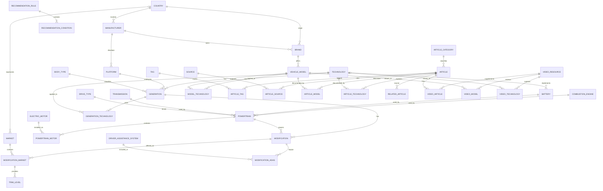

# Проект реляционной базы данных

## 1. Принципы

Схема ориентирована на PostgreSQL и Django ORM. Она нормализует повторяющиеся сущности и отношения, но оставляет простые атомарные характеристики в таблице владельца. Например, тип кузова является справочником, а длина модификации — обычным числовым полем.

Общие правила:

- первичные ключи — внутренние `bigint`;
- публичные URL используют уникальный `slug`, где это уместно;
- даты создания и изменения добавляются к редактируемым сущностям;
- неизвестные значения — `NULL`;
- физические единицы фиксированы названием поля и документацией;
- используемые справочники защищаются от случайного удаления;
- M:N-связи с собственными атрибутами имеют явную промежуточную таблицу.

Для основных редактируемых предметных сущностей предусматриваются необязательные поля `source_url` и `source_note`. Статьи используют отдельный реестр `source`; привязка отдельных структурированных фактов к нескольким источникам отложена до появления такого требования.

## 2. Основные таблицы

### Организации и автомобили

| Таблица | Основные поля | Связи и ограничения |
|---|---|---|
| `country` | `name`, `iso_code` | уникальные `name`, `iso_code` |
| `manufacturer` | `name`, `slug`, `country_id`, `founded_year`, `description`, `is_active` | N:1 к стране |
| `brand` | `manufacturer_id`, `origin_country_id`, `name`, `slug`, `founded_year`, `discontinued_year`, `description`, `is_active` | N:1 к производителю и стране; уникально `(manufacturer_id, name)` |
| `vehicle_model` | `brand_id`, `name`, `slug`, `segment`, `description`, `production_status`, `is_active` | N:1 к марке; уникально `(brand_id, name)` |
| `platform` | `manufacturer_id`, `name`, `slug`, `description`, `is_active` | платформа может использоваться несколькими поколениями |
| `body_type` | `code`, `name` | небольшой справочник |
| `generation` | `model_id`, `platform_id`, `body_type_id`, `name`, `code`, `start_year`, `end_year`, `description`, `is_active` | проверка `end_year >= start_year`; уникальность имени в модели |
| `modification` | `generation_id`, `powertrain_id`, `name`, `slug`, размеры, масса, места, багажник, разгон, максимальная скорость, расход/запас хода, `is_active` | сравниваемая единица; уникально `(generation_id, name)` |

Размеры хранятся в миллиметрах, масса — в килограммах, скорость — в км/ч, разгон — в секундах, расход топлива — в л/100 км, расход энергии — в кВт·ч/100 км, запас хода — в км. Для запаса хода дополнительно хранится текстовый код цикла измерения (`CLTC`, `WLTP`, другой).

### Силовая установка

| Таблица | Основные поля | Связи и ограничения |
|---|---|---|
| `combustion_engine` | `manufacturer_id`, `code`, `fuel_type`, `displacement_cc`, `cylinders`, `induction`, `power_kw`, `torque_nm` | повторно используемый агрегат |
| `electric_motor` | `manufacturer_id`, `code`, `motor_type`, `power_kw`, `torque_nm` | повторно используемый агрегат |
| `battery` | `manufacturer_id`, `name`, `chemistry`, `gross_capacity_kwh`, `usable_capacity_kwh`, `voltage_v`, `technology_id` | полезная ёмкость не больше полной |
| `transmission` | `manufacturer_id`, `name`, `transmission_type`, `gears` | справочник агрегатов |
| `drive_type` | `code`, `name` | `FWD`, `RWD`, `AWD` |
| `powertrain` | `type`, `combustion_engine_id`, `battery_id`, `transmission_id`, `drive_type_id`, `system_power_kw`, `system_torque_nm` | тип: `ICE`, `BEV`, `HEV`, `PHEV`, `EREV` |
| `powertrain_motor` | `powertrain_id`, `electric_motor_id`, `axle`, `quantity` | явная M:N; уникально для мотора и позиции в установке |

`powertrain` выделен отдельно, потому что одинаковая конфигурация агрегатов может использоваться несколькими модификациями. Ограничения состава по типу проверяются в модели/сервисе и покрываются тестами; простые проверки диапазонов дублируются ограничениями БД.

### Рынки и оснащение

| Таблица | Основные поля | Связи и ограничения |
|---|---|---|
| `market` | `name`, `code`, `country_id` (nullable) | рынок может быть страной или регионом |
| `modification_market` | `modification_id`, `market_id`, `sales_name`, `available_from`, `available_to` | уникально `(modification_id, market_id)` |
| `trim_level` | `modification_market_id`, `name`, `price_amount`, `currency_code`, `valid_from`, `valid_to`, `equipment_summary`, `is_active` | цена относится к рынку и периоду |

Связь модели с рынком выводится через доступные модификации. Отдельная `model_market` не создаётся, чтобы не дублировать факт.

### Технологии и ADAS

| Таблица | Основные поля | Связи и ограничения |
|---|---|---|
| `technology` | `name`, `slug`, `category`, `description`, `is_active` | общая или фирменная технология |
| `model_technology` | `model_id`, `technology_id`, `note` | M:N на уровне семейства |
| `generation_technology` | `generation_id`, `technology_id`, `note` | M:N для конкретного поколения |
| `driver_assistance_system` | `name`, `slug`, `category`, `level`, `description`, `is_active` | каталог систем/функций |
| `modification_adas` | `modification_id`, `adas_id`, `availability`, `note` | M:N; стандартно/опция/недоступно |

Технология привязывается к самому узкому достоверному уровню. Не следует одновременно создавать одинаковую связь на модели и поколении без смысловой причины.

## 3. Контент базы знаний

| Таблица | Основные поля | Связи и ограничения |
|---|---|---|
| `article_category` | `name`, `slug`, `description` | одна основная категория статьи |
| `tag` | `name`, `slug` | уникальные имя и slug |
| `source` | `name`, `publisher`, `url`, `accessed_at`, `notes`, `is_active`, timestamps | уникальный URL источника |
| `article` | `category_id`, `author_id`, `title`, `slug`, `summary`, `body`, `status`, `published_at`, timestamps | статус `draft`/`published`/`archived` |
| `article_tag` | `article_id`, `tag_id` | M:N |
| `article_source` | `article_id`, `source_id` | M:N между статьями и подтверждающими источниками |
| `article_manufacturer` | `article_id`, `manufacturer_id` | связь с производителями/концернами |
| `article_brand` | `article_id`, `brand_id` | связь с марками |
| `article_model` | `article_id`, `model_id` | связь с моделями |
| `article_generation` | `article_id`, `generation_id` | связь с поколениями |
| `article_modification` | `article_id`, `modification_id` | связь с модификациями |
| `article_platform` | `article_id`, `platform_id` | связь с платформами |
| `article_technology` | `article_id`, `technology_id` | связь с технологиями |
| `article_adas` | `article_id`, `adas_id` | связь с системами помощи водителю |
| `related_article` | `from_article_id`, `to_article_id`, `relation_type` | направленная связь; запрет самоссылки |
| `video_resource` | `title`, `description`, `url`, `provider`, `thumbnail_url`, `published_at`, `is_active`, timestamps | уникальный `url`; видео хранится у внешнего видеопровайдера |
| `video_article` | `video_resource_id`, `article_id` | явная M:N-связь с внутренними статьями |
| `video_model` | `video_resource_id`, `model_id` | явная M:N-связь с моделями автомобилей |
| `video_technology` | `video_resource_id`, `technology_id` | явная M:N-связь с технологиями |

Явные промежуточные таблицы увеличивают их число, но сохраняют внешние ключи и понятную целостность. Для видео намеренно выбраны только три наиболее полезные связи: статья, модель и технология. Универсальная связь вида `(entity_type, object_id)` не используется, так как PostgreSQL не сможет обеспечить внешний ключ к разным таблицам.

## 4. Структуры информационного поиска

Отдельные таблицы поискового индекса и внешних результатов в первой версии не создаются. `search` читает существующие доменные таблицы, а PostgreSQL строит полнотекстовый документ из их полей.

| Группа выдачи | Таблицы | Веса `SearchVector` |
|---|---|---|
| `Articles` | `article` | `title` — A, `summary` — B, `body` — C |
| `Cars` | `manufacturer`, `brand`, `vehicle_model`, `generation`, `modification` | название/код — A, описание — C |
| `Technologies` | `technology`, `platform`, `driver_assistance_system` | название — A, категория — B, описание — C |
| `Videos` | `video_resource` | `title` — A, `description` — B, `provider` — D |

`SearchVector`, `SearchQuery` и `SearchRank` применяются через `django.contrib.postgres.search`. Для русскоязычных описаний предварительно используется FTS-конфигурация `russian`; значение должно быть настраиваемым. Точные названия, латинские марки, индексы моделей и аббревиатуры дополнительно участвуют в точном/триграммном сопоставлении.

Для `pg_trgm` создаётся расширение PostgreSQL миграцией `TrigramExtension`. GIN/GiST-триграммные индексы добавляются только на короткие поля, реально участвующие в нечётком поиске: названия сущностей и заголовки материалов. Длинные тексты не индексируются триграммами.

Для полнотекстового поиска предусматриваются GIN expression indexes, выражение которых совпадает с используемым взвешенным `SearchVector`. Если выбранная версия Django/PostgreSQL затруднит сопровождение expression index, допустим `SearchVectorField`, обновляемый контролируемым способом; оба варианта одновременно не используются. Окончательный вариант фиксируется перед миграциями и подтверждается `EXPLAIN` на демонстрационном наборе.

Поисковый запрос, итоговые DTO и ответы `ExternalSearchProvider` не являются постоянными сущностями. Внешняя выдача не сохраняется в основной базе данных.

## 5. Правила рекомендаций

| Таблица | Основные поля | Связи и ограничения |
|---|---|---|
| `recommendation_rule` | `name`, `code`, `description`, `rule_kind`, `weight`, `explanation_template`, `priority`, `is_active` | `rule_kind`: hard/soft; уникальный `code` |
| `recommendation_condition` | `rule_id`, `field`, `operator`, `value_json`, `negate` | несколько условий правила |

`field` и `operator` выбираются только из белых списков приложения. `value_json` хранит типизированное значение или короткий массив значений; это осознанное применение JSON для разнородных операндов правил, а не замена предметной схемы. Правило с несколькими условиями в первой версии использует логическое AND. Более сложные деревья выражений отложены.

Пользовательские ответы в первой версии можно не сохранять. Если появится требование к истории подборов, для неё проектируется отдельная таблица после определения срока хранения и правил приватности.

## 6. ER-диаграмма

Диаграмма показывает ключевые связи; простые поля и некоторые однотипные таблицы связей сокращены ради читаемости.

## 7. Индексы и целостность

- Индексы создаются на всех внешних ключах, slug, статусах публикации и часто используемых фильтрах.
- Составные индексы определяются по реальным запросам; вероятные кандидаты: `(brand_id, production_status)`, `(generation_id, is_active)`, `(market_id, modification_id)`.
- Полнотекстовые GIN-индексы обязательны для полей, перечисленных в разделе 4; выражение индекса должно совпадать с выражением поискового запроса.
- Триграммные индексы и порог сходства должны проверяться тестами на типичных опечатках и через `EXPLAIN`, чтобы fallback не превращался в полный просмотр больших таблиц.
- Частичные индексы по возможности исключают черновики статей и неактивные видео/сущности из публичного поиска.
- Числовые параметры имеют `CHECK >= 0`; годы и интервалы дат проверяются на порядок.
- `PROTECT` применяется к используемым справочникам и основным родителям; контент при необходимости архивируется.
- Удаление пользователя-автора не должно удалять статью: используется защита или системный автор согласно выбранной политике.

## 8. Что намеренно осталось полем

Сегмент, статус выпуска, химия батареи, тип топлива, тип трансмиссии, цикл измерения и валюта на первом этапе являются ограниченными строковыми перечислениями, а не отдельными таблицами. Они не имеют собственного описания и связей, поэтому отдельные таблицы усложнили бы защиту без полезного знания. При появлении управляемых справочников или локализации решение можно пересмотреть.
